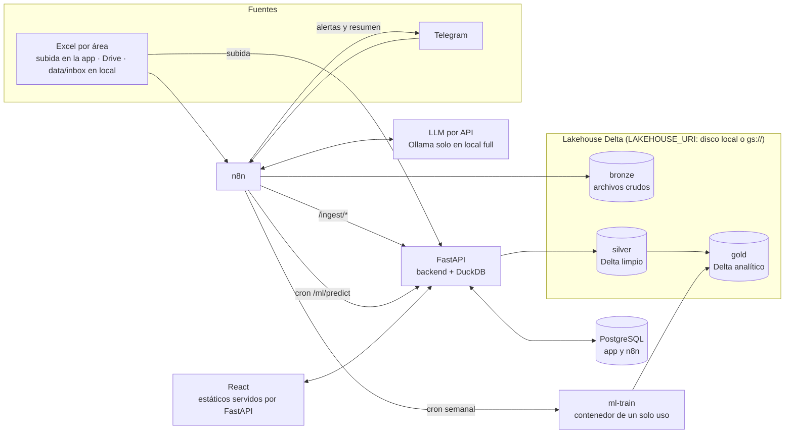

# Arquitectura — Avícola 2: plataforma de planificación de saca

Especificación técnica de referencia. Las reglas de trabajo para agentes están en [`CLAUDE.md`](../CLAUDE.md), los supuestos pendientes en [`assumptions.md`](assumptions.md) y las decisiones en [`adr/`](adr/).

---

## 1. Proceso actual (As-Is, preliminar)

> **No está confirmado** (ver [assumptions.md](assumptions.md)). No acoplar la lógica a este orden de pasos.

**Actores:** Gerencia Comercial · Horeca (pollerías / Brasa) · Supermercados y Tiendas · Producción · Distribución.

1. Horeca envía proyecciones de Brasa **por WhatsApp** (texto libre).
2. Supermercados y Tiendas registran pedidos en **ARIS** (sistema actual).
3. Gerencia Comercial consolida a mano WhatsApp + ARIS (y sus Excel).
4. Comercial y Producción calculan la saca con idas y vueltas.
5. Producción planifica la producción y la saca se envía a Distribución.
6. Distribución trae el pollo vivo a planta.
7. Recién entonces Comercial envía los pedidos a Producción.
8. Se valida si la saca coincide con los pedidos:
   - **Coincide:** beneficiar y producir → distribuir pedidos → fin.
   - **Falta pollo:** recarga para el día siguiente → % de recorte → priorizar clientes → volver a beneficiar.
   - **Sobra pollo:** recategorizar, beneficiar al día siguiente o eliminar (merma).

| Código | Problema | Cómo lo ataca la plataforma |
|---|---|---|
| F1 | Proyecciones por WhatsApp, sin formato ni trazabilidad | Captura por mensajería con extracción por LLM |
| F2 | Consolidación manual de varias fuentes (doble registro) | Ingesta automática de Excel hacia el lakehouse |
| F3 / E1 | La saca se negocia sin un dato único | Forecast compartido + saca sugerida en la app |
| F4 | El descuadre se detecta tarde | Alertas tempranas de forecast vs. saca planificada |
| F5 | Recargas y recortes por falta de pollo | Mejor precisión del forecast |
| F6 | El excedente se decide caso a caso (merma) | Forecast + histórico de excedentes visible |
| E2 | Espera por la llegada del pollo vivo | Fuera de alcance (logística física) |

---

## 2. Vista general



### Responsabilidades (no duplicar lógica)

| Componente | Hace | No hace |
|---|---|---|
| **n8n** | Detectar archivos, guardar crudos en bronze, llamar endpoints, cron, notificaciones, flujos con LLM | Transformar datos, aplicar lógica de negocio ni escribir en la base de la app |
| **FastAPI** | API, lógica de negocio, bronze→silver→gold, predicción, consultas con DuckDB, `ingestion_log` | Programar tareas ni enviar mensajes |
| **ml-train** | Entrenamiento y backtest (mismo código del backend, otro proceso) | Atender peticiones de usuario |
| **PostgreSQL** | Estado transaccional de la app (bases `app` y `n8n`) | Histórico analítico |
| **Lakehouse** | Histórico analítico y archivos crudos | Datos transaccionales |
| **React** | UI por rol | Lógica de negocio |

### Stack
- **Frontend:** React + Vite + TypeScript, shadcn/ui + Tailwind, TanStack Query, Recharts, pnpm. Refine es opcional (solo si el equipo ya lo conoce).
- **Backend:** Python 3.12, FastAPI, SQLAlchemy 2 + Alembic, Pydantic v2, uv, ruff.
- **Datos:** `deltalake` (delta-rs), DuckDB (extensión `delta`), pandas, openpyxl.
- **ML:** statsforecast, lightgbm, scikit-learn (métricas), `holidays` (feriados de Perú).
- **Orquestación e IA:** n8n self-hosted. LLM configurable (`anthropic` | `ollama`).
- **Infra:** Docker Compose. En GCP, una VM de Compute Engine + GCS + Caddy (ver [ADR 0001](adr/0001-almacenamiento-gcs-y-despliegue-en-vm.md)).

---

## 3. Lakehouse (medallion sobre Delta)

Raíz: `LAKEHOUSE_URI`. En local es `./data/lakehouse`; en GCP, `gs://<bucket>/lakehouse`.

- **bronze:** archivos tal cual llegan, en `bronze/{fuente}/{AAAA}/{MM}/{DD}/{archivo}`. También guarda los mensajes crudos en JSON. Nunca se modifica.
- **silver:** tablas Delta validadas contra `backend/config/schemas.yaml` (sección 5). Las columnas de abajo son **ilustrativas**; la fuente de verdad es el YAML.
  - `orders`: date, channel, customer, product, qty_kg, source_file, ingested_at
  - `projections`: date, channel, customer, product, qty_kg, source (excel | message), source_ref, ingested_at
  - `saca`: date, planned_birds, planned_kg, actual_kg, source_file
  - `surplus_events`: date, product, qty_kg, destination (recategorize | next_day | discard)
- **gold:**
  - `daily_demand`: date × channel × product → qty_kg (base del entrenamiento; ver "demanda censurada" en [assumptions.md](assumptions.md))
  - `forecast`: date, channel, product, yhat, yhat_lo, yhat_hi, model, model_version, created_at
  - `forecast_vs_plan`: date, channel, forecast_kg, projected_kg, saca_kg, deviation_pct

**Reglas:**
- Las escrituras usan `merge` (upsert) por las `merge_keys` del YAML, para que volver a subir un Excel corregido no duplique filas.
- **Un solo escritor:** solo el backend o `ml-train` escriben en Delta, con escrituras serializadas mediante un lock.
- `model_version` guarda la versión Delta de `gold.daily_demand` usada para entrenar.
- **No ejecutar `VACUUM`** con una retención que borre versiones referenciadas por modelos registrados.
- DuckDB se configura con `SET memory_limit` y `SET threads` desde `.env`. Sobre GCS, se lee la tabla con `deltalake` y se consulta el dataset Arrow con DuckDB, con lo que no hacen falta claves HMAC.

---

## 4. PostgreSQL (app)

- `users` (id, name, email, role, **channel**, password_hash).
  - Roles: `comercial`, `produccion`, `distribucion`, `canal`, `admin`.
  - `channel` es obligatorio cuando el rol es `canal`, y limita qué datos ve y edita el usuario.
- `saca_plans` (id, date, suggested_kg, suggested_birds, planned_kg, status, created_by, approved_by, notes).
  - `status` es `varchar` validado desde la configuración, **no un ENUM de Postgres**. Valores iniciales: `draft | proposed | approved | rejected`.
- `saca_plan_comments`: idas y vueltas Comercial ↔ Producción.
- `ingestion_log` (id, file_name, source, rows_ok, rows_error, errors_json, status, created_at). **Lo escribe el backend** en `/ingest/*`.
- `column_mappings` (source_signature, mapping_json, status, confirmed_by): mapeos propuestos por el LLM y confirmados por una persona.
- `alerts` (id, date, type, message, severity, acknowledged_by).

Migraciones con Alembic. Un solo contenedor de Postgres con dos bases: `app` y `n8n`.

---

## 5. Contrato de datos y esquema configurable

**Todavía no se conocen las columnas reales.** El forecast solo necesita:

| Campo | Tipo | Obligatorio |
|---|---|---|
| `date` | fecha | Sí |
| `channel` | texto | Sí |
| `product` | texto | Sí (si no existe, `"TOTAL"`) |
| `qty_kg` | número ≥ 0 | Sí |

Los campos opcionales (`customer`, `responsible`, `type`, saca real, excedentes) enriquecen el análisis, pero su ausencia no debe romper nada.

- **Ningún esquema de silver va fijo en el código.** Todo se define en `backend/config/schemas.yaml`.
- **Orden de mapeo de columnas:** alias del YAML → mapeo confirmado en `column_mappings` → propuesta del LLM (pendiente de confirmación).
- **La granularidad es configurable,** y los parámetros del ML dependen de ella (sección 7).
- Se usan nombres sin sufijo `_id` (`customer`, `product`) en el YAML, en silver y en gold.

```yaml
# backend/config/schemas.yaml (ejemplo inicial, sujeto a cambio)
granularity: daily          # daily | weekly
tables:
  orders:
    merge_keys: [date, channel, customer, product]
    columns:
      date:     {type: date,   required: true,  aliases: [fecha, fecha_pedido, dia]}
      channel:  {type: string, required: true,  aliases: [canal, area]}
      customer: {type: string, required: false, aliases: [cliente, local, tienda]}
      product:  {type: string, required: true,  default: TOTAL, aliases: [producto, item]}
      qty_kg:   {type: float,  required: true,  min: 0, aliases: [cantidad, kilos, kg, peso]}
```

### Plantilla Excel estándar
- Hoja `datos` con las columnas: `fecha | canal | cliente | producto | cantidad_kg | tipo | responsable`.
  - `canal`: Horeca / Supermercados / Tiendas.
  - `producto`: lista desplegable.
  - `cantidad_kg`: número ≥ 0.
  - `tipo`: proyeccion / pedido.
- Nombre de archivo: `{canal}_{responsable}_{AAAAMMDD}.xlsx`.
- Se genera con openpyxl, con validaciones de datos, en `data/templates/`.
- Los Excel que no cumplen la plantilla pasan por la normalización con IA (sección 8.2).

---

## 6. De demanda a saca

Una **saca sugerida = suma del forecast** subestima la saca de forma sistemática, porque el forecast está en kg de producto beneficiado y la saca es de pollo vivo. Por eso:

```
kg_producto  = Σ forecast del día (yhat) + margen (basado en yhat_hi, configurable)
kg_vivo      = kg_producto / yield_factor
aves         = kg_vivo / avg_live_weight_kg
```

- `yield_factor` (rendimiento de carcasa y proceso) y `avg_live_weight_kg` se configuran en `.env` o en una tabla de parámetros. Sus valores reales están por validar.
- `saca_plans` guarda tanto `suggested_kg` como `suggested_birds`.

---

## 7. Machine learning (forecast de demanda)

- **Objetivo:** demanda en kg por canal × producto (o canal × TOTAL), con un horizonte configurable (`FORECAST_HORIZON`, entre 1 y 14 días por defecto).
- **Parámetros según la granularidad:**

| | `daily` | `weekly` |
|---|---|---|
| Estacionalidad | 7 | 52 |
| Naive estacional | mismo día de la semana anterior | misma semana del año anterior (o la semana anterior si hay poca historia) |
| Lags LightGBM | 1, 7, 14, 28 | 1, 2, 4, 52 |
| Calendario | día de la semana, día del mes, quincena, fin de mes, feriados | semana del año, ¿la semana contiene un feriado o pico? |

- **Modelos, en orden:**
  1. Baseline naive estacional (obligatorio).
  2. StatsForecast (AutoETS / AutoARIMA).
  3. LightGBM global (fase 1b o fase 2) con pocos árboles y `n_jobs` configurable.
- **Fechas pico:** feriados de Perú, Fiestas Patrias, Navidad, Año Nuevo, Día de la Madre (segundo domingo de mayo) y Día del Pollo a la Brasa (tercer domingo de julio).
- **Validación:** backtesting con rolling origin; nunca un split aleatorio. **Métricas:** WAPE (principal), MAE y sesgo, guardadas por modelo y versión.
- **Selección:** gana el menor WAPE en backtest (por serie o global), con fallback a StatsForecast si hay poca historia.
- **Ejecución:**
  - `ml-train` corre como contenedor de un solo uso (`docker compose run --rm ml-train`), lanzado por el cron semanal.
  - **Nunca se entrena dentro del proceso de la API**: la compilación JIT de numba en StatsForecast genera picos de RAM.
  - `POST /ml/predict` solo carga modelos ya entrenados.
- **Endpoints:**
  - `POST /ml/train`: encola o dispara `ml-train`.
  - `POST /ml/predict?horizon=14`: escribe en `gold.forecast`.
  - `GET /ml/metrics`.
- **Artefactos:** en `backend/models/` (local) o en `{LAKEHOUSE_URI}/models/` (GCP), en joblib con metadatos.
- **Datos sintéticos:** `scripts/generate_synthetic.py` genera unos 18 meses diarios para 3 canales y entre 4 y 6 productos, con tendencia, estacionalidad, picos, ruido **y días con recorte**. También genera Excel de ejemplo con formatos distintos.

---

## 8. IA generativa (vía n8n)

LLM configurable con `LLM_PROVIDER=anthropic|ollama`. En la nube y en la laptop antigua se usa la API; Ollama queda solo para el perfil `full` en local.

1. **Captura de proyecciones (F1).** Telegram → el LLM extrae un JSON validado con esquema (fecha, cliente, producto, kg) → si falta información, repregunta → bronze → `POST /ingest/message` → silver `projections` con `source=message`.
2. **Normalización de Excel heterogéneos (F2).** Si las columnas no coinciden, el LLM propone un mapeo → se guarda en `column_mappings` como pendiente → una persona lo confirma en la app → las siguientes cargas con la misma firma se mapean solas.
3. **Asistente de consulta (fase 2).** Chat → agente de n8n → `POST /analytics/query` del backend. El backend **impone** una lista blanca de tablas gold, el modo de solo lectura y un límite de filas; no confía en el LLM para eso.
4. **Resumen diario (fase 2).** El LLM redacta el forecast, las desviaciones y la saca sugerida, y se envía a Producción y Comercial.

---

## 9. Workflows de n8n

Se exportan como JSON en `n8n/workflows/`.

| Workflow | Trigger | Pasos |
|---|---|---|
| `01_ingesta_excel` | Local: Local File Trigger **con polling** sobre `/data/inbox`. GCP: Google Drive Trigger (opcional) | Guarda en bronze → `POST /ingest/transform` → avisa los errores que devuelve el backend |
| `02_captura_mensajes` | Telegram Trigger | LLM extrae → valida → bronze → `POST /ingest/message` → confirma al remitente |
| `03_forecast_diario` | Cron diario (madrugada) | `POST /ml/predict` → desviaciones → alertas → notifica |
| `04_reentrenamiento` | Cron semanal | `POST /ml/train` → notifica métricas |
| `05_resumen_diario` (fase 2) | Cron diario | Consulta gold → el LLM redacta → envía |
| `06_agente_consultas` (fase 2) | Webhook desde la app | Agente IA con herramienta SQL de solo lectura |

**Notas:**
- **Local File Trigger:** los eventos de archivos de Windows no llegan a contenedores Linux por bind mount, por eso se usa polling. Hay que verificar que el nodo esté habilitado en la versión de n8n que se use (algunas versiones lo bloquean por defecto). Si no está, usar un Schedule Trigger que liste la carpeta.
- **Telegram Trigger:** necesita una URL HTTPS pública. En GCP la da Caddy. En local hace falta un túnel (cloudflared) o un flujo de polling con `getUpdates`.
- **Acceso a archivos:** `N8N_RESTRICT_FILE_ACCESS_TO=/data/inbox`.
- **Llamadas al backend:** por el nombre del servicio, `http://backend:8000`.

---

## 10. Backend (FastAPI): módulos

- `auth`: login con JWT, roles y filtro por `channel`.
- `ingest`: `/ingest/upload`, `/ingest/transform`, `/ingest/message`, `/ingest/mappings` (listar y confirmar). Escribe `ingestion_log`.
- `ml`: train, predict y metrics.
- `saca`: CRUD de planes, flujo de aprobación, comentarios y cálculo de la saca sugerida (sección 6).
- `analytics`: consultas a gold (forecast vs. plan, histórico, excedentes) y `/analytics/query` con lista blanca.
- `alerts`: listar y marcar como atendidas.
- `chat` (fase 2): proxy al webhook de n8n.
- **Estáticos:** sirve el build del frontend en `/`.

---

## 11. Frontend: pantallas por rol

- **Dashboard** (todos): forecast vs. proyección vs. saca vs. real, KPIs (WAPE, desviación, merma) y alertas.
- **Planes de saca** (Comercial y Producción): lista, detalle, saca sugerida (kg y aves), edición, comentarios y aprobación.
- **Proyecciones** (canales, solo su canal): carga manual y subida de Excel.
- **Ingestas** (admin): log, errores por fila y confirmación de mapeos.
- **Modelos** (admin): métricas por versión y botón de reentrenar.
- **Asistente** (fase 2): chat.
- **Usuarios** (admin).

---

## 12. Docker Compose y perfiles

| Servicio | Puerto | `lite` | `full` | Notas |
|---|---|---|---|---|
| `postgres` | 5432 (solo red interna) | ✓ | ✓ | Bases `app` y `n8n` |
| `n8n` | 5678 | ✓ | ✓ | |
| `backend` | 8000 | ✓ | ✓ | Sirve el frontend compilado |
| `ml-train` | — | ✓ (se ejecuta bajo demanda) | ✓ | `docker compose run --rm ml-train` |
| `caddy` | 80 / 443 | GCP | — | HTTPS automático |
| `frontend-dev` | 5173 | — | ✓ | Vite en modo desarrollo |
| `ollama` | 11434 | — | ✓ | En Windows, Ollama nativo también sirve |

- **Meta del perfil `lite`:** menos de unos 2.5 GB de RAM sumando los `mem_limit` de los servicios permanentes.
- Todo se parametriza en `.env`: hilos, memoria, `LLM_PROVIDER`, `FORECAST_HORIZON`, `LAKEHOUSE_URI`, `yield_factor`, etc.
- `.env.example` documenta cada variable.
- Imágenes slim (`python:3.12-slim`, alpine donde se pueda).

---

## 13. Despliegue en GCP

Ver [ADR 0001](adr/0001-almacenamiento-gcs-y-despliegue-en-vm.md). En resumen:
- **Compute Engine:** una VM (referencia `e2-medium`) con Docker y el perfil `lite` + `caddy`.
- **Almacenamiento:** un bucket de GCS para el lakehouse (`LAKEHOUSE_URI=gs://...`), con autenticación por la cuenta de servicio de la VM.
- **Postgres:** en contenedor, sobre disco persistente, con `pg_dump` diario al bucket.
- **Red:** firewall abierto solo en 80 y 443.

---

## 14. Plan de construcción

**MVP (fase 1), como camino vertical primero:**
1. Infra: compose `lite`, Postgres con Alembic y `LAKEHOUSE_URI` local.
2. `scripts/generate_synthetic.py` y la plantilla Excel.
3. Ingesta: `/ingest/upload` y `/ingest/transform` (bronze → silver → gold) + workflow `01`.
4. ML: baseline + StatsForecast con backtest, `ml-train`, `/ml/predict` y workflows `03` y `04`.
5. Frontend: login, dashboard y planes de saca con aprobación.
6. IA: workflow `02` (Telegram) y normalización de columnas.
7. Despliegue en GCP (VM + GCS + Caddy).

**Fase 2:** LightGBM, asistente de consulta, resumen diario, pantalla de modelos y mejoras.

**Definición de terminado por paso:** levanta con `docker compose --profile lite up`, tiene tests mínimos (validación de ingesta y backtest) y el README está actualizado.
